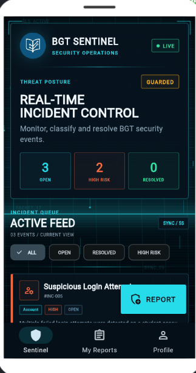
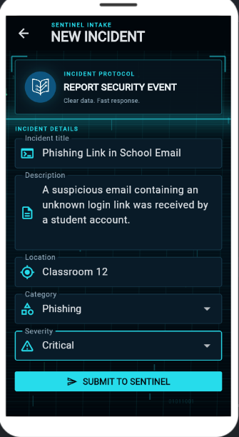
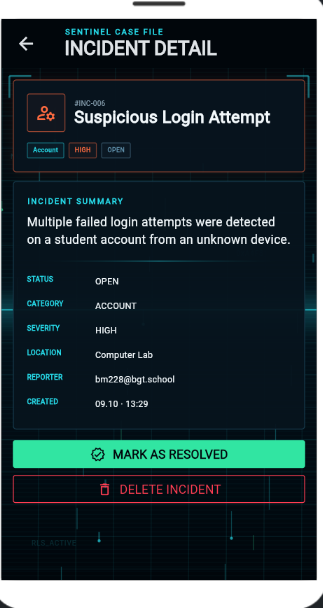

# BGT Sentinel

**Cybersecurity Incident Command Center**

BGT Sentinel is a cybersecurity incident reporting and monitoring application designed for the British Gymnasium of Technology. It gives authenticated users one secure place to report, monitor and resolve cybersecurity incidents inside the school.

## Purpose

The purpose of BGT Sentinel is to make security incidents easier to report and manage. Instead of information being scattered, incidents are stored in one database and shown through a live security dashboard.

## Main Features

- Login and registration with Supabase Auth
- Cybersecurity incident reporting form with validation
- Incident categories: Phishing, Account, Network, Device and Other
- Severity levels: Low, Medium, High and Critical
- Live incident dashboard
- Automatic refresh every 5 seconds
- Server-side filters for Open, Resolved and High Risk incidents
- Personal **My Reports** section filtered by the authenticated user's `user_id`
- Full incident detail page
- Owner can mark an incident as resolved
- Owner can delete their own incident
- Dark and light mode
- Secure logout
- Material 3 interface
- Animated cybersecurity command-center visual effects

## Security

BGT Sentinel uses Supabase Row Level Security (RLS).

Each incident contains a `user_id` linked to the authenticated user. Authenticated users can read incidents, while update and delete operations are protected so that only the owner of the incident can perform them.

The database uses four RLS policies:

- Authenticated users can read incidents
- Users can create incidents as themselves
- Owners can update their incidents
- Owners can delete their incidents

## Database

The main table is:

`incidents`

Main fields:

- `id`
- `user_id`
- `author`
- `title`
- `description`
- `category`
- `location`
- `severity`
- `status`
- `created_at`

The SQL used to create the table, validation rules and RLS policies is included in:

`Day5_SQL.txt`

## Technologies

- Flutter
- Dart
- Material 3
- Supabase
- Supabase Auth
- PostgreSQL
- Row Level Security
- REST API
- HTTP
- JSON
- StreamController
- StreamBuilder
- Timer.periodic

## Live Data

The dashboard refreshes automatically every 5 seconds.

`StreamController`, `StreamBuilder` and `Timer.periodic` are used so that new or updated incidents can appear without restarting the application.

## Screenshots

### Sentinel Dashboard

### Report Incident

### Incident Details

The planning sketch is also included as:

`K1_Sketch.png`

## How to Run

1. Open the Supabase project.
2. Run the SQL from `Day5_SQL.txt` in the Supabase SQL Editor.
3. Open the Flutter project in FlutLab.
4. Make sure the `http` package is included in `pubspec.yaml`.
5. Make sure `assets/bgt_logo.png` exists and is declared in `pubspec.yaml`.
6. Open `main.dart`.
7. Run the application.
8. Create an account or log in.
9. Report and manage cybersecurity incidents through BGT Sentinel.

## Project Evidence

- `K1_Sketch.png` - planning sketch and user flow
- `Day5_Plan.txt` - project plan
- `Day5_SQL.txt` - database structure, constraints and RLS policies
- `main.dart` - complete Flutter application
- `screenshots/` - final application evidence

## Possible Future Improvements

- Incident image uploads
- Search by incident title
- Push notifications for critical incidents
- Administrator dashboard
- Incident history and analytics

## Project

**Project:** BGT Sentinel  
**Student:** Beis Morina  
**Activity:** Internal Internship - Week III - Day 5  
**School:** British Gymnasium of Technology

**Detect. Report. Resolve.**